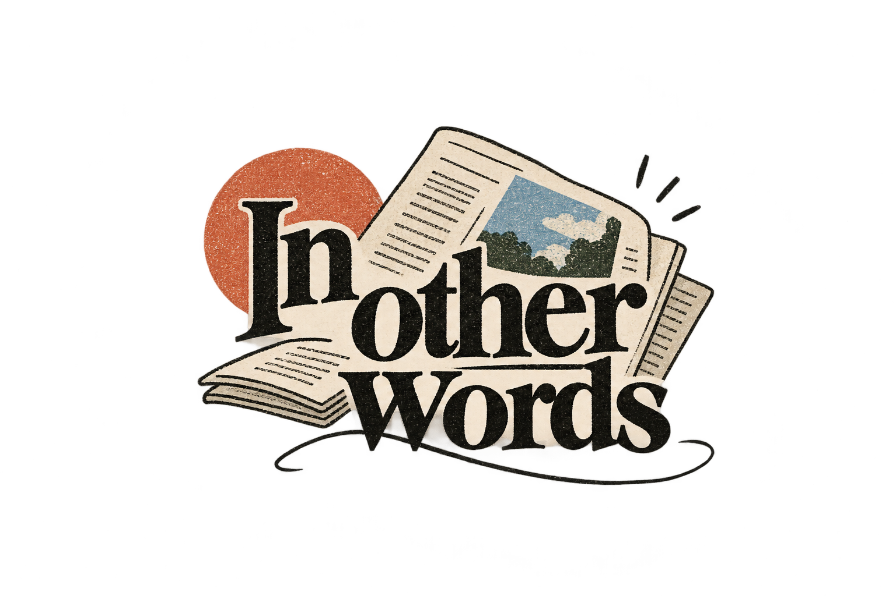

<p align="center">
  
</p>

<h1 align="center">In Other Words — Newsletter Studio</h1>

<p align="center">
  A modern, editorial-first newsletter creation and publishing platform. Design, write, collaborate, and export print-ready newsletters with intuitive layout controls, AI writing assistants, and seamless multi-page editorial workflows.
</p>

<p align="center">
  
  
  
  
  
  
</p>

<p align="center">
  <strong><a href="https://hootsworth.github.io/psychic-octo-giggle/">🌐 View Live Demo on GitHub Pages</a></strong>
</p>

---

## 📖 Overview

**In Other Words** is built for editorial teams, student publications, independent writers, and creative studios who want the elegance of traditional print media combined with the speed and power of modern web technologies. 

Craft beautiful multi-page newsletters, refine text with AI-assisted tone and style adjustments, organize publishing schedules, and export high-fidelity PDFs ready for print or digital distribution.

---

## ✨ Features

- 📰 **Multi-Page Visual Editor**: Design structured 3-page editorial issues with flexible modular blocks including cover art, featured articles, poetry, photo galleries, event boards, interviews, timelines, and statistics.
- 🎨 **Curated Editorial Templates**: Quick-start templates tailored for various publication styles:
  - *Campus Weekly* — Balanced news, student voices, and event roundups
  - *Literary Review* — Spacious layout for poetry, fiction, essays, and artwork
  - *Events & Culture* — Dynamic digest of happening events, clubs, and spotlights
  - *Research & Science* — Academic reporting, timelines, data, and findings
  - *Blank Slate* — Full creative freedom from scratch
- 🤖 **AI-Powered Writing Assistant**: Integrated OpenAI and Google Gemini support to rewrite, adjust tone, expand/summarize articles, and translate text according to your publication's style guide.
- 📄 **Print & PDF Export**: Export publication-grade vector-rendered PDFs and high-resolution snapshots powered by `jspdf` and `html2canvas-pro`.
- 🗂️ **Editorial Workflow & Pipeline**: Track article status across drafting, review, scheduling, and publication stages.
- 📚 **Public Issue Archive**: Showcase past published issues in a clean, accessible digital archive for readers.
- 🔐 **Authentication & Multi-Tenant Storage**: Secure authentication and persistent cloud storage backed by Supabase.

---

## 🛠️ Tech Stack

- **Frontend Framework**: [React 19](https://react.dev/)
- **Routing**: [React Router v7](https://reactrouter.com/)
- **Build Tooling**: [Vite 8](https://vite.dev/)
- **Styling**: [Tailwind CSS v4](https://tailwindcss.com/) with `@tailwindcss/vite`
- **Typography**: Newsreader Serif & DM Sans
- **Database & Auth**: [Supabase](https://supabase.com/) (`@supabase/supabase-js`)
- **PDF Generation**: [jsPDF](https://github.com/parallax/jsPDF) & [html2canvas-pro](https://github.com/niklasvh/html2canvas)
- **Formatting**: [oxfmt](https://github.com/oxc-project/oxc)

---

## 📁 Project Structure

```text
├── public/
│   ├── favicon.svg              # Site favicon
│   └── logo.png                 # Brand logo
├── src/
│   ├── app/
│   │   ├── BrandLogo.tsx        # Reusable brand logo component
│   │   ├── Editor.tsx           # Multi-page visual newsletter editor
│   │   ├── Dashboard.tsx        # Overview & issue manager
│   │   ├── Workflow.tsx         # Editorial workflow & status pipeline
│   │   ├── Publishing.tsx       # Distribution and publishing options
│   │   ├── Archive.tsx          # Public issue reader & archive
│   │   ├── Settings.tsx         # Style, AI provider, and team settings
│   │   ├── Auth.tsx             # Sign in / Sign up view
│   │   ├── AuthContext.tsx      # Auth session provider & protected routes
│   │   ├── ai.ts                # AI rewriting API integration
│   │   ├── templates.ts         # Pre-configured newsletter templates
│   │   ├── store.ts             # Local/cloud newsletter state
│   │   └── supabaseClient.ts    # Supabase connection client
│   ├── App.tsx                  # Root app component
│   ├── main.tsx                 # Entrypoint
│   └── index.css                # Global stylesheet & Tailwind CSS v4 setup
├── supabase/
│   └── functions/               # Supabase Edge Functions (e.g. AI rewrite proxy)
├── index.html                   # HTML shell
├── package.json                 # Dependencies and scripts
├── tsconfig.json                # TypeScript configuration
└── vite.config.ts               # Vite configuration
```

---

## 🚀 Getting Started

### Prerequisites

- [Node.js](https://nodejs.org/) (v18 or higher recommended)
- [pnpm](https://pnpm.io/) or [npm](https://www.npmjs.com/)

### Installation

1. Clone the repository:
   ```bash
   git clone https://github.com/Hootsworth/psychic-octo-giggle.git
   cd psychic-octo-giggle
   ```

2. Install dependencies:
   ```bash
   npm install
   # or
   pnpm install
   ```

3. Configure Supabase credentials (if connecting your own Supabase instance):
   Update the configuration in `utils/supabase/info.tsx` or configure environment variables.

4. Start the development server:
   ```bash
   npm run dev
   # or
   pnpm dev
   ```

5. Open your browser and navigate to `http://localhost:5173` (or the port specified in terminal).

### Building for Production

To create an optimized production build:
```bash
npm run build
```

To preview the production build locally:
```bash
npm run preview
```

---

## 🤝 Contributing

Contributions, feedback, and issue reports are welcome!
1. Fork the project
2. Create your feature branch (`git checkout -b feature/amazing-feature`)
3. Commit your changes (`git commit -m 'Add amazing feature'`)
4. Push to the branch (`git push origin feature/amazing-feature`)
5. Open a Pull Request

---

## 📄 License

This project is licensed under the MIT License.
